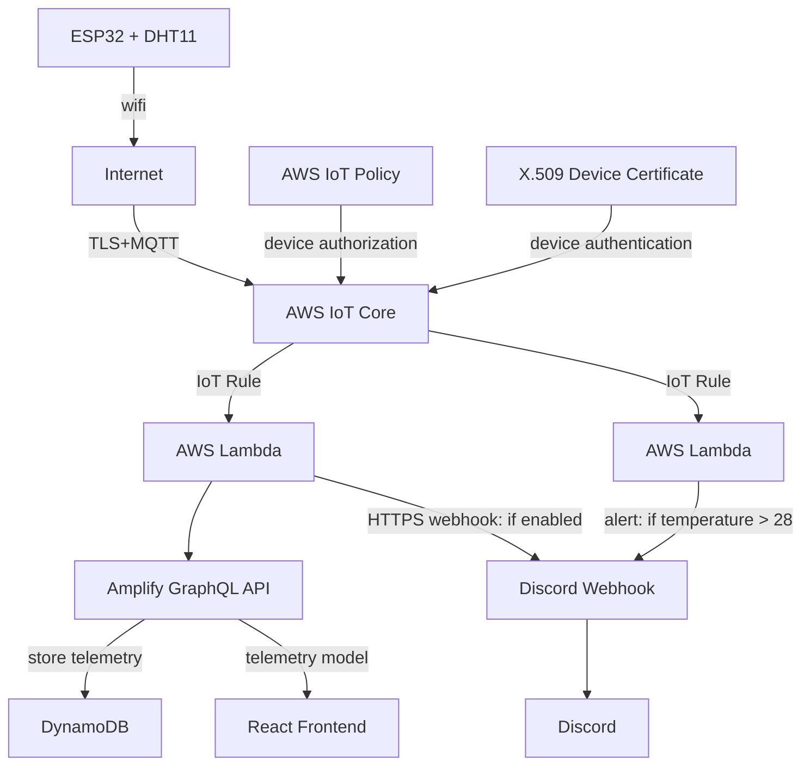

## System Architecture

ESP32-enheten samlar in data om temperatur och luftfuktighet med hjälp av en DHT11-sensor och skickar den på ett säkert sätt till AWS IoT Core via MQTT över TLS.

AWS IoT Core använder två IoT-regler: den ena aktiverar en Lambda-funktion som bearbetar och lagrar telemetridata i DynamoDB via Amplify GraphQL-API:et, medan den andra skickar en varning via Discord när temperaturen överstiger 28 °C.

Lambda-funktionen skickar även regelbundna notiser till Discord, förutsatt att detta har aktiverats för enheten. React-gränssnittet hämtar enhetsinformation och sensordata via Amplify GraphQL-API:et.

Säkerheten säkerställs genom X.509-enhetscertifikat, AWS IoT-policyer och TLS-kryptering.

